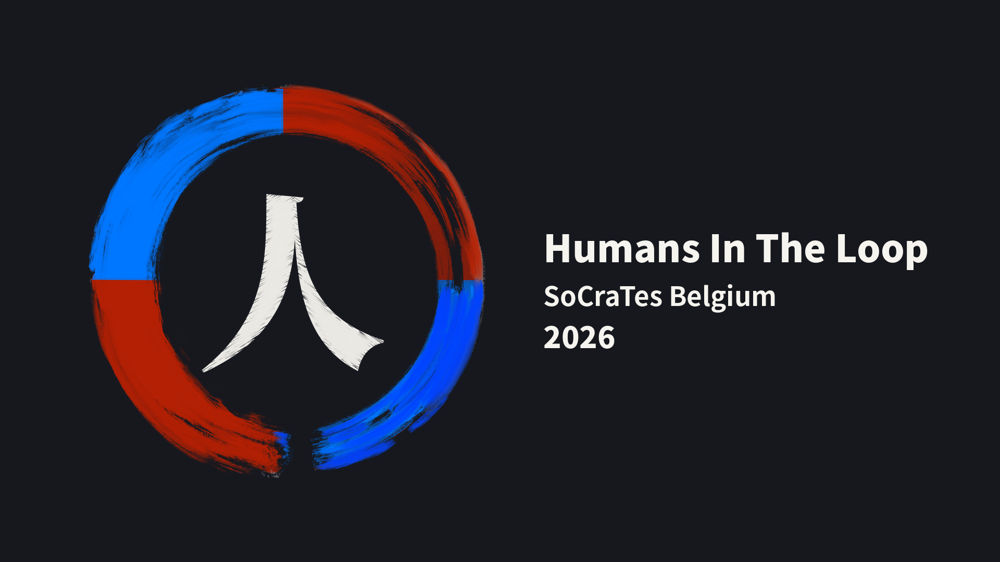
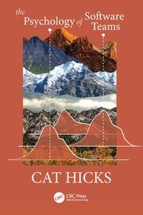
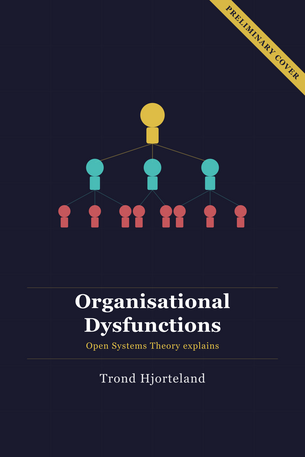

[SocratesBE](https://socratesbe.org) just ended and triggered a powerful emotional response within me that I feel I need to share.

## Some context

All of these following things have (had) an impact on my experience and thought process that would culminate in a cathartic release at SocratesBE's closing ceremony on Saturday evening.

I've been seeing different agile/agile-adjacent (un)conferences announce they're closing down for good. XPDays Benelux, and AgileCoachCamp most recently. Yet, I was also present at AgileLeanEurope in Leuven in August this year.

All over I'm reading how AI is continuously changing my job. At times with disdain, at times with overhype.

During Socrates France this year, an experiment was run where session hosts would add an "AI" or "No AI" tag to their post-its, so that participants had a clear idea what they'd be going into.

At Kunlabora this "divide" is also noticeable. Our Slack is full of posts of "here's what glorious new thing AI did for me today" and "here's yet another questionable/horrible choice of a frontier AI provider".

At BREWTCon, the Belgian conference for testers, there was a separate AI track, to accommodate the needs of the attendees.

Even for [KTConf](https://ktconf.be), the Belgian Kotlin developer conference I organize, we curated the talks and speakers so that there'd be a "good mix" of AI and non-AI topics, with Wouter Groeneveld providing a critique of AI-driven development as a closing talk.

Recently I also started reading _The Psychology of Software Teams_, by Dr. Cat Hicks. In it she mentions there's a dynamic happening in teams that initially have a common purpose and as such provide a sense of belonging. A team in which a divide can occur that impacts this sense of belonging. A clique within a community kind of situation, which sometimes is disruptive enough to disband said community.

## No AI tags

Having noticed (and perhaps contributed to) the AI vs. anti-AI opposition, I decided to not repeat the SocratesFR agreement of annotating session post-its with AI/no-AI.

In sharing this with the group, we suggested that since we also don't discriminate based on which programming language you use, or whether you're a manager, developer, analyst or tester, we also shouldn't discriminate based on our feelings towards AI. The "we" that suggested this to the group being Vincent and myself, facilitators of this edition of the SocratesBE unconference.

Just before we introduced the open space explanation I was feeling a bit gloomy; something I was unable to discover the source of at the time.

## The first session

During the first session of SocratesBE, about _Psychology of Software Teams_, Jan Van Ryswyck presented some excerpts from the book (mainly about Brains-in-Jars thinking) as group discussion ensued. The room was absolutely packed. There was a moment I realized that everyone in that room understood what the author was trying to say, but that the content is wasted on us.

So I voiced my take:

> We aren't the ones that need to read this. In fact, the people that should be reading it likely never will.

Now read that again, but imagine your voice cracking as you are mid-sentence.

Again, I still had no idea where that feeling was coming from, but I had a hint: it's related to the unfairness that everyone in this amazing community has to deal with.

When that session was over, Nelis Boucké, someone that's not been able to join the unconference in the last 5-odd years, reached out and asked if I was ok.

He offered advice by sharing how he always focuses on the team he works with, and looks for improvements to their happiness bit by bit; a view that I share completely. Inadvertently he had shown me a mirror in combination with caring words.

Over the course of that day and the next, I started feeling better; less gloomy. I had an amazing time (re-)connecting with the other attendees.

## The closing

When the time came to facilitate the closing I suggested to copy the closing of SocratesFR: say something if you want and pass the speech token (Kodee, the Kotlin mascot) to your right.

I started off by not saying something myself and handing it to Bouke, who kicked things off with words of thanks and celebrating the respectful discussion of AI and non-AI views.

As I listened to regulars and newbies alike, I had a very strong sense that the people in this community decided to not allow the opposing views to disrupt the sense of belonging.

More than that, Thomas Thiry shared an anecdote of a newbie who was randomly pulled into a regular's coding session to share what they were creating; Thomas heard the newbie mention that because of it, they truly felt accepted. It reminded me how the people help each other throughout these days and care for one another. Of having been there in that newbie's position. Of how Nelis helped me in that first session. Of how this is a community I feel so proud being a part of.

And so, when Kodee found his way into my hands again, I felt a strong need to share this idea. When I did, however, the crack in my voice appeared again, along with a flood of tears. Eventually, I managed my way through everything I needed to say and passed Kodee to my right again.

We had to cut the loop short due to food being ready. But some people came over and offered a much welcome hug. If you're one of those people: thank you again for sharing your comforting embrace.

A few people said to me afterwards that the emotions I showed came as a complete surprise, because I had always come across as someone who knows what they're doing when facilitating. I guess the jig is up, haha.

So yeah, having that cathartic moment, as a facilitator, and experiencing the community's caring mentality myself, makes me all the more proud of SocratesBE and the safe space for being this vulnerable that we built over the years and try so hard to retain.

I love you all dearly.

If you are also experiencing what an attendee appropriately called _AI-confusion_, or the existential dread that comes along with it, I hope you can rely on the people around you to make you feel better. And if you can't, there's always room in the SocratesBE community. ❤️

Thanks for reading!

## Book references

- 
  [_The Psychology of Software Teams_](https://www.routledge.com/The-Psychology-of-Software-Teams/Hicks/p/book/9781032963389) by Dr. Cat Hicks
- 
  [_Organisational Dysfunctions: Open Systems Theory Explains_](https://leanpub.com/organisationaldysfunctions) by Trond Hjorteland

